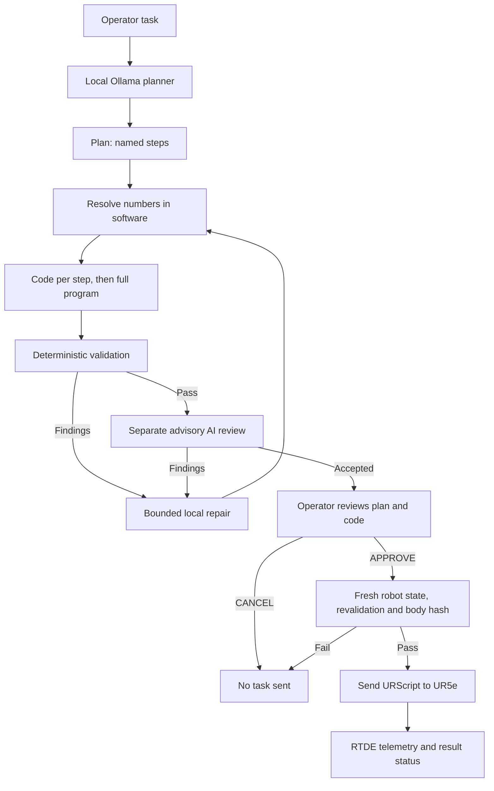

<div align="center">

# UR5e AI Motion Planner

**Natural language in. Deterministically validated robot motion out.**

Local-first AI-assisted planning, operator review and monitored URScript execution for the **Universal Robots UR5e**.

**Created by Xamdamov Abu Bakr**


[Architecture](#execution-flow) · [Documentation](#technical-documentation) · [Setup](#setup) · [Safety](#safety-boundaries)

</div>

---

## Overview

- **Local AI:** planning runs through Ollama. **The original real-robot setup was tested with `gpt-oss:20b`**. Other compatible Ollama chat models may be selected explicitly in `limits.py`, but have not been validated for this project. There is no cloud model and no silent model fallback.
- **Structured planning:** a request becomes named steps. Each step is turned into exact robot instructions.
- **Advisory second review:** a separate model call checks the candidate against the request after deterministic validation. This is not a second independent safety system.
- **Deterministic validation:** the program is checked against workspace, speed, acceleration, joint, and gripper limits **and against the arm's own reach** (see *Reach envelope*). The validator is the authority; the review is advisory.
- **Reach envelope + selective `ADJUSTED` targets:** an eligible Cartesian request can be adjusted toward a reachable position, and the modified target is shown for approval. Saved poses, HOME, arcs, shapes and joint commands do not receive the same automatic adjustment.
- **Local repair:** a failing step is repaired on its own, then the full program is re-validated (at most 3 repair attempts).
- **Operator approval:** AI tasks and corner tours require approval after the plan, code, validation and review are displayed. Startup homing and `/home` follow a separate validated path without that task approval dialog.
- **Fail closed:** an invalid, unconfirmed, or stale program is never sent as if it succeeded.

## Execution flow



All arithmetic (poses, deltas, arcs, polygon corners) is done by software, not by the model. The model proposes primitives and parameters; deterministic code validates them. The controller performs its own motion interpolation.

## Technical documentation

[**Read the 29-page engineering report (PDF)**](docs/UR5e_AI_Motion_Planner_Technical_Documentation_v2.1.pdf) — architecture, geometry, local AI integration, kinematics, validation, communication and execution states.

**Version note:** the report describes a different code snapshot from this release. In particular, the current source implements `base_rotate`, a wider workspace, a separate base keep-out check and the `/robot fixed` option with route retracing. The executable source and `limits.py` are authoritative for this publication; the report is retained unchanged as an engineering reference.

## Project structure

```text
.
├── main.py           # Terminal commands, approval workflow
├── ui.py             # Colours, spinner with expandable log, key input, APPROVE/CANCEL buttons
├── tour.py           # /robot corner tour: plan builder + inverse-kinematics reachability check
├── prompts.py        # Planner, step-repair, code, and review prompts
├── limits.py         # Connection, workspace, speed, gripper, and behaviour settings
├── ai_agent.py       # Local LLM calls, planning, review, and repair loop
├── robot_sender.py   # Live state, validator, geometry, URScript transport, home, stop
├── docs/             # Technical engineering report (PDF)
├── SECURITY.md       # Security disclosure and robot safety boundaries
├── .gitignore        # Generated files, local environments and execution records
└── README.md
```

Generated files: `approval/` holds the approved code for every executed program, and `reports/` holds failure and diagnostic reports.

## Requirements

- A **UR5e** controller reachable from the computer on the network. External URScript control may require the controller to be in **Remote Control** mode.
- **Python 3.13 or newer** (Python 3). No particular patch version is required. The original setup used Python **3.14.4**; later interpreters are accepted by the version guard but have not all been runtime-validated.
- [Ollama](https://ollama.com/) running locally with an installed chat model; the **tested model is `gpt-oss:20b`**. The Python implementation uses standard-library modules and has no pip dependency file.
- For the gripper: an **OnRobot RG2/RG6** with its URCap installed and the OnRobot Setup page configured on the Teach Pendant.

## Offline regression checks

```bash
python -m unittest discover -s tests -v
```

These checks cover interpreter-version acceptance, configuration consistency and a few deterministic validator branches. They use simulated state and do **not** contact a real robot or Ollama. They are not a physical safety verification.

## Setup

### 1. Check Python and Ollama

```bash
python --version
ollama list
```

If the tested model is missing, run `ollama pull gpt-oss:20b`. You may also choose another Ollama chat model in `limits.py` using its **exact installed tag** (for example, change `OLLAMA_MODEL` to a tag displayed by `ollama list`). Model-dependent JSON quality, instruction following, tool support and `think` options may differ. When a model does not support the configured thinking level, check Ollama's model capabilities and adjust `LLM_THINK`/`LLM_RETRY_THINK` in `limits.py` if needed. **Only `gpt-oss:20b` was tested for this project.** The application never silently switches models or downloads one by itself.

### 2. Configure `limits.py`

All settings live in the editable block at the top of `limits.py`:

- `ROBOT_IP`, `URSCRIPT_PORT`, `DASHBOARD_PORT`, `RTDE_PORT`: controller network settings. The public `ROBOT_IP` is an intentionally invalid address placeholder (`192.168.X.X`); insert your own address before LIVE use and **do not commit it**.
- `OLLAMA_MODEL`: defaults to the tested `gpt-oss:20b`; another installed compatible model can be configured, but that configuration is **untested**.
- `HOME_POSE`: the verified home TCP pose `[x, y, z, rx, ry, rz]` (metres, rotation vector in radians).
- `X_MIN` … `Z_MAX`: the configured TCP workspace for the original cell, not a manufacturer limit. Keep them separate from `HOME_POSE`. A valid home pose does not widen the workspace. The robot is not obliged to reach the maximum: where the arm cannot reach, the reach envelope (section K) adjusts the target. **Turning the base by 180° from `HOME_POSE`** (TCP radius about 0.51 m) sweeps the TCP over y = ±0.511 m and ends at x = −0.492 m, so `X_MIN` and the Y limits must reach at least that far or the validator refuses the rotation.
- `MAX_TCP_SPEED`, `MAX_TCP_ACCELERATION`, and the default motion values.
- Gripper range, fingertip offset, and timing values.

The program refuses to move while the configuration is inconsistent, for example when `HOME_POSE` lies outside the workspace. It reports the conflict at startup.

### 3. Reach envelope (section K of `limits.py`)

The box in section D is only the TCP workspace of your cell. Before any move is accepted, the validator also solves the arm's inverse kinematics from the **live joints and the live tool offset** along the whole path and requires that:

- a joint solution exists and no joint leaves its range;
- the elbow and wrist 2 stay away from singular poses;
- the arm is not stretched beyond `REACH_COMFORT_FRACTION` (90 %) of its maximum, so it never goes to the maximum;
- a capsule model of the links, the tool, the base column and the table shows no contact (`SELF_COLLISION_MARGIN_M` clearance).

A target that fails this can be **ADJUSTED** for eligible target modes such as `pose`, `xyz_m`, `delta_xyz_m`, direction-based moves and `to_limits`: X and Y are kept and only the height is changed first; if no height works the move is pulled back along its path. An adjusted target always stops `REACH_ADJUST_BUFFER_M` (2 cm) before the edge of the arm's reach. The plan prints an `ADJUSTED` block that says this is **not** the workspace limit: the robot finds that position hard to reach. A move that ends *inside the arm's reach* but beyond the workspace box is still refused (or shortened with `stop_at_limit`): the box is a hard limit. Arcs (`movec`) are not adjusted; they are refused if the arm cannot do them.

Model result for ONE configuration (UR5e, tool pointing down, RG2 with fingertips, tool length 0.228 m): the highest comfortable TCP height falls from about 0.60 m at 0.25 m from the base axis to about 0.27 m at 0.75 m, and next to the base the arm cannot go lower than about 0.10 to 0.17 m. These numbers are NOT a specification and NOT symmetric around the base: the reach also depends on the direction (the wrist offset and the tool orientation change the effective reach), and they will differ for another tool or orientation. Check them on your robot.

The capsule radii in section K are generous round numbers, not the real housings. **This is not certified collision checking**; it does not know about obstacles, cables or a workpiece.

### 4. Start

```bash
python main.py              # LIVE mode: connects to the robot
python main.py --dry-run    # simulation only: no robot is contacted, every result is labelled SIMULATED
```

In LIVE mode the program reads the robot state and can **automatically move to `HOME_POSE` at startup** if its readiness checks pass; this homing step does **not** use the AI-task approval dialog. If checks fail, homing is skipped and the reason is reported. Run only with an authorized, clear and verified robot cell.

**Before the first LIVE start:** verify the controller address, HOME pose, robot setup, tooling, operating mode, available safety functions and cell clearance. Have a physical emergency stop accessible. The supplied HOME and workspace numbers are specific to the original setup and must not be assumed safe for another installation.

## Terminal commands

| Command | Purpose |
|---|---|
| `/help` | Show commands and the supported primitives. |
| `/status` | Show robot state, readiness, and the active limits. |
| `/ai <task>` | Plan a task. Plain text without `/ai` also works. |
| `/home` | Validated move to `HOME_POSE`. |
| `/robot [speed] [stay] [fixed]` | Visit the corners of the workspace box one after another at the fastest allowed speed (or the given one), then return to the start pose (`stay` = do not return). By default the tool turns about the vertical with the arm's azimuth around the base (`fixed` keeps the tool orientation, which makes corners behind the base unreachable). Every segment is checked with the reach envelope: unreachable corners are skipped, unreachable corners may be adjusted or skipped, and if the straight way home is blocked the tour retraces its verified path. No AI: the plan is built by software and goes through the same validator and approval. |
| `/log` | Show the process log of the last AI task or tour. |
| `/cls` | Clear the screen. (`/clear` forgets the task context; it does not touch the screen.) |
| `/limit <name> <value>` | Change a limit for this session only (for example `/limit z_max 400mm`). |
| `/settings` | Show settings. `/settings live on\|off` locks execution without changing the simulation mode. |
| `/clear` | Forget the current task context. Hardware and settings are not changed. |
| `/stop`, `stop`, `s` | Immediate software stop. Handled outside the AI, so it works during planning and execution. |
| `/exit` | Quit. The robot is not commanded to stop or move. |

## Terminal interface

- **Task length:** a task for the AI must be 7-1000 characters (`UI_MIN_TASK_CHARS` / `UI_MAX_TASK_CHARS` in `limits.py`).
- **Status line:** while the AI works or the robot moves, an animated line shows the stage (`Thinking`, `Writing code`, `Validating`, `Reviewing`, `Executing` ...) and the elapsed time. Press **Enter** to show or hide the full process log; `/log` shows it later.
- **Stop:** press **`s`** while something runs (no Enter needed). At the prompt `s`, `stop` or `/stop` + Enter still works.
- **Approval:** two buttons, switched with **← →**, confirmed with **Enter**, **Esc** cancels. The focus starts on **CANCEL**, so APPROVE always needs a deliberate key press. Without a real terminal (pipes) you type `APPROVE` as before.
- **Prompt:** coloured dot and mode tag: green `LIVE` ready, yellow `LOCK` execution locked, red `BLOCKED`, magenta `DRY`. **↑ ↓** history, **Tab** completes commands, **Ctrl+L** clears the screen, **Esc** clears the line.
- Colours switch off with `NO_COLOR=1` or `UI_COLOR = False`; `UI_ASCII = True` replaces the symbols for old consoles.

## Supported primitives

| Primitive | What it does |
|---|---|
| `movel` | Straight TCP move: by offset, absolute pose, return to a saved pose (`start`, `session_start`), relative distance along a direction (optionally `stop_at_limit`), rotation about a base axis, move until a limit (1 mm margin), or `to_limits` (go to workspace limit positions on any of x, y, z, e.g. "xmax ymax zmin"). Targets the arm cannot comfortably reach are ADJUSTED, with a note. |
| `movej` | Joint-space move, only as the first motion: explicit joint angles, or `{"base_rotate":{"angle_deg":180,"via":"+Y"}}` (or `"-Y"`) which turns only joint 1 so the arm swings around the base through +Y or −Y (never over +Z). The joint speed is chosen so the TCP stays under the TCP speed limit (about 36 s for 180° from `HOME_POSE` at 0.05 m/s). |
| `movec` | Circular arc through a via point (or from a plane, centre direction, and radius). |
| `polygon` | Regular n-sided polygon through the current point (3–12 sides). |
| `circle` | Full circle through the current point, built from two 180° arcs. |
| `repeat` | Repeat a block of steps N times (N ≤ 20), expanded into validated lines. |
| `gripper` | OnRobot `rg_grip(width_mm, force_N)` through the URCap. |
| `sleep` | Wait up to 10 s. |
| `home` | Move to `HOME_POSE`. |

Not implemented, and rejected rather than guessed: `movep`, distance queries, loops with conditions, sensors and cameras, inverse-kinematics goals for Cartesian orientations, and any other URScript.

## Example

```text
/ai move 20 mm up, then return to the exact starting position and hold
```

Expected terminal flow: the planner reads the live state itself (you are not asked for coordinates), the plan and code are shown, the validator reports PASS, and the program waits for `APPROVE`.

## Execution results

| Status | Meaning |
|---|---|
| `COMPLETED_CONFIRMED` | Completion inferred from the available end marker / pose / speed checks, or gripper width readback within tolerance. This is **not** a safety-rated motion verification. |
| `COMPLETED_WIDTH_MISMATCH` | Gripper width read back, but not at the target. Often an object in the fingers. Check the gripper. |
| `COMPLETED_TIMED` | Program sent and the expected time passed, but no end signal or width value was received. Not confirmed by software. |
| `SENT_NOT_CONFIRMED` | Sent, but completion could not be confirmed. The robot's state is unknown. Check it before any new command. |
| `STOPPED` | A stop was requested during execution. |
| `REFUSED` | Not sent: validation, approval, live state, or a safety check failed. |
| `FAILED` | The send or a safety check failed. The fault is latched and new motion is blocked until the program is restarted. |
| `SIMULATED` | Dry-run only. Nothing was sent to any robot. |

## Safety boundaries

> **Experimental software. Not safety-rated and not certified for production use.**

- The physical emergency stop is the primary stop. `/stop` is a software stop and does not replace it.
- The program never powers on the robot, releases brakes, or clears protective stops. Do those on the Teach Pendant.
- Read the plan and the code before typing `APPROVE`. The approved program is saved in `approval/`.
- Workspace checks apply to the TCP path. The reach envelope adds an approximate self-collision check, but it does **not** prove that links, the gripper, or a workpiece stay clear of obstacles in your cell.
- A successful send is not proof of a completed task. Check the cell after every run, especially after `SENT_NOT_CONFIRMED` or `COMPLETED_TIMED`.
- Keep speed and acceleration conservative, and keep people and obstacles out of the motion envelope.

## Current limitations

- Collision checking is an approximation. The TCP path is checked against the workspace limits, and the arm's own links, tool, base column and the table are checked with a capsule model (see *Reach envelope*). External obstacles, cables and workpieces are **not** known to the program.
- The reach validator uses local numerical inverse kinematics, not a global obstacle-aware motion planner. It does not prove that the controller will select the same joint branch or avoid external obstacles.
- Tool contact, force-based reactions, and conditional branches (if/else) are not implemented.
- Gripper width is limited to 106 mm: the OnRobot URCap clamps the command to `110 − 2 × fingertip offset`, and the program rejects larger values instead of letting the URCap clamp them silently.
- Gripper width confirmation needs the RTDE output register `output_double_register_0`. Without it, gripper moves report `COMPLETED_TIMED`.
- Remote URScript cannot call the URCap's own functions directly. The gripper is driven through the URCap's XML-RPC server on the controller (`localhost:41414`). This works on the tested setup; verify it on your controller after any URCap or firmware update.

## Reach rules in detail (what the validator and the planner do)

- **`pose_ref` and `home` are never adjusted.** "Return to the start" is exact or it is refused with a question ("rotate the base back (base_rotate with the same side) or choose another target"). After a base turn the straight way back crosses the base column, so it is refused; turn the base back with `base_rotate` through the **same side** it came from (the opposite side would need joint 1 = ±2π and is refused with the numbers).
- **Targets that ARE adjusted automatically:** `pose`, `xyz_m`, `delta_xyz_m`, `move` with a distance, `until_limit`, `to_limits`. The search runs in the vertical half-plane of the target (same azimuth around the base axis; radius and height may both shrink), picks the point nearest to the request and keeps `REACH_ADJUST_BUFFER_M` (2 cm) inside the edge of the arm's reach. Polygon sides, circles/arcs (`movec`) and joint moves are **not** adjusted: they are refused with a question that does not promise an adjustment.
- **`xyz_m`:** `{"xyz_m":[x,y,z]}` is an absolute position that keeps the CURRENT tracked orientation. Use it after `base_rotate` (the live state still shows the orientation from before the turn).
- **`base_rotate`** (and any `movej`) is only possible as the **first motion** of a plan, because the joint angles are only known from the live state. The orientation after the turn is computed from the joints (`R_flange(q) * R_tool`), so a following `movel` is checked correctly.
- **Base keep-out:** the TCP path may not enter a cylinder around the base axis (`BASE_KEEPOUT_RADIUS_M` = column + tool + margin = 0.20 m, below `BASE_KEEPOUT_HEIGHT_M` = 0.60 m). It is enforced for `movel`, `movec` and `movej` **even when `REACH_CHECK_ENABLED = False`**; the arm's own reach and self-collision are then NOT checked and the program prints a warning at start, in `/status` and in the approval block.
- **Tool rotations in place** are sampled at most `REACH_MAX_ROT_STEP_RAD` (0.10 rad) apart, so a 20-90° tool turn is checked in small steps instead of one joint jump. Failure messages name the joint and the size of the jump.
- **`ROOM`** (what the planner is told about the room in each direction) marks what ends it first: `(arm reach)`, `(self-collision)` or `(base column)`.
- **Dry-run:** the simulation keeps the joint angles after every simulated move (also after a base turn), so a base turn followed by a `movel` can be tried without a robot. The pose after a joint move is estimated from nominal kinematics for the simulation only; on the real robot completion of a joint move is confirmed by the end marker, not by the pose.

### Known limitations of the reach model

- Capsule radii are generous round numbers, not the real housings. This is not certified collision checking and it does not know obstacles, cables or a workpiece.
- Straight segments between two corners are checked at `REACH_SAMPLE_STEP_M` spacing; arcs and joint moves at `PATH_SAMPLE_STEP_M`.
- Rotating the tool in place by more than about 20° about the base X axis toward the forearm can be refused by the 2 cm self-collision margin (the opposite direction is fine); this is a verdict of the capsule model, not a measurement.
- In `/robot fixed` mode joint 6 can swing by almost 5 rad (it winds up); the default mode (the tool turns with the arm) keeps it under 1 rad.
- **Validation scope:** the original project was tested on physical UR5e hardware, as reported by the author, using `gpt-oss:20b`. The publication edits (IP placeholder, Python version policy and documentation) have been inspected offline; this distributed copy has not been rerun on the robot.

## Design principles

1. **Local-first:** planning uses Ollama, with `gpt-oss:20b` as the tested configuration.
2. **Separation of concerns:** the model plans; software computes numbers, validates, and communicates with the robot.
3. **No invented coordinates:** missing or ambiguous information leads to a clarifying question or a clear refusal.
4. **Approval for planned tasks:** operator approval is required for AI tasks and `/robot` tours; startup and `/home` homing are exceptions.
5. **Fail closed:** failed validation or unconfirmed execution is never reported as success.

## References

- [Universal Robots](https://www.universal-robots.com/): robot platform and documentation.
- [Ollama](https://ollama.com/): local model runtime.
- [OnRobot](https://onrobot.com/): RG2/RG6 gripper and URCap documentation.

---

<p align="center"><sub>Developed by Xamdamov Abu Bakr · Experimental research software · Physical setup tested with gpt-oss:20b</sub></p>